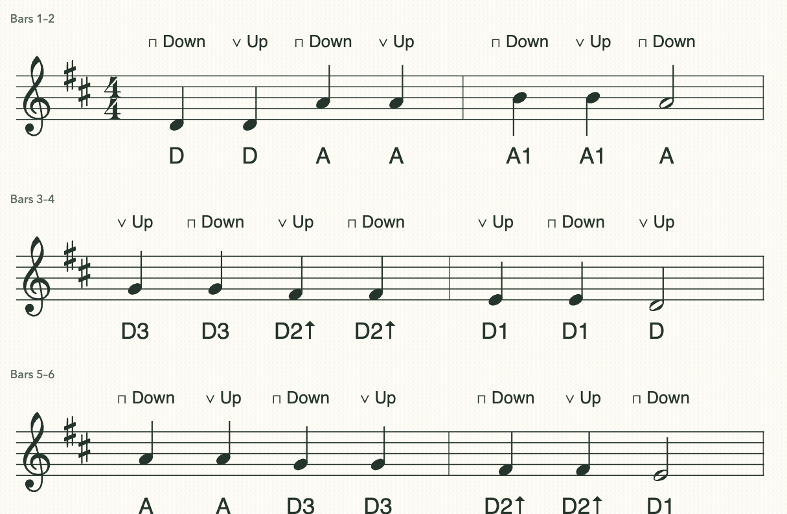

<a name="english"></a>

# Stringbook · Violin fingering and bowing for beginners

[English](#english) · [简体中文](#zh-cn)

Know the tune but still have to stop and work out where your fingers go? Stringbook writes the **string and finger below each note** and the **bow direction above it**. Follow the staff for rhythm, hear the melody at your pace, then print the same markings for your music stand.

[Printable score and practice card (2-page PDF)](docs/media/twinkle-practice-score.pdf) · [Included songs](#included-songs) · [Feature status](#feature-status) · [Run Stringbook](#run-stringbook)



[Open the full-size demo](docs/media/notes-and-bowing.gif) · [View a still screenshot](docs/media/annotated-score.png)

The first five notes of *Twinkle, Twinkle, Little Star* read **D · D · A · A · A1**. Play the open D string twice, the open A string twice, then put your index finger on the A string. Later, **D2↑** means a high second finger on the D string. Select that note to see the finger position and bow direction on the violin.

## Included songs

These seven beginner violin scores come with a fresh install and work offline. Open **Switch piece** to play one, or search by either name.

| Song | Chinese title | Edition in Stringbook |
| --- | --- | --- |
| Baa, Baa, Black Sheep | 咩咩黑绵羊 | *The Baby’s Opera*, upper-staff melody |
| Frère Jacques | 两只老虎 | Stringbook setting of the traditional round |
| Here We Go Round the Mulberry Bush | 我们绕着桑树转 | *The Baby’s Opera*, upper-staff melody |
| Hush-a-by Baby | 宝宝摇篮曲 | *The Baby’s Opera*, upper-staff melody |
| Jingle Bells | 铃儿响叮当 | Stringbook setting of Pierpont’s refrain |
| Row, Row, Row Your Boat | 划船歌 | Stringbook’s even-beat setting of the traditional round |
| Twinkle, Twinkle, Little Star | 小星星 | Stringbook’s D-major setting of the traditional melody |

The three *Baby’s Opera* melodies are adapted from Linda Cantoni’s MusicXML transcriptions for the Project Gutenberg edition, listed as public domain in the United States. The other four are project arrangements of public-domain tunes. Personal imports stay in your local library. [Edition credits and reuse terms](THIRD_PARTY_NOTICES.md#music-in-the-public-catalogue)

## Feature status

**Tested** means the named workflow has been exercised on the supported Apple Silicon Mac. **Testing** means you can try it now, but the musical result still needs checking against the source.

| Feature | Status | What you can try |
| --- | --- | --- |
| Score, fingering and bowing | Tested | Select a note, inspect both hands, edit a finger or bow, or transpose the piece. The practice card shows the fingerings used. |
| Playback, saving and printing | Tested | Slow down, count in, start from a note or loop two bars. Save, reopen and print the edited score with its practice card. |
| Title search | Tested | Search starters by English or Chinese title, or fetch a specific OpenScore Lieder edition. Try **小星星** offline or **Just for Today** online. |
| Score photo or PDF recognition | Testing | Simple printed examples have been checked. Curved phone photos and multi-part pages can produce wrong notes or rhythms. Choose the melody part and compare it with the original. [Sample image](samples/rhythm.png) · [Sample PDF](samples/placement.pdf) |
| Audio-to-score conversion | Testing | Start with a short solo recording. Check pitches and timing by ear, especially with accompaniment. [Four-second sample](samples/melody.wav) |

The import tests exercise file selection through export. Recognition quality was measured separately on a limited set of scores and recordings. Beginner feedback on which suggested fingerings and bowings feel comfortable is still pending. [Test coverage and measured results](TESTING.md)

## Run Stringbook

The setup script supports **macOS on Apple Silicon**. Install Node.js 24 with npm, uv, FFmpeg and Google Chrome first. [Prerequisite commands and setup details](INSTRUCTIONS.md#recreate-the-environment)

```sh
git clone https://github.com/dhtim135/violin-for-beginner.git
cd violin-for-beginner
./scripts/setup.sh
./scripts/start.sh
```

Open **[Stringbook on localhost](http://127.0.0.1:8427)**. *Twinkle* is ready to play. For a first practice loop, set **Speed** to **0.75×**, turn on **Loop bars**, choose bars **1–2**, and press **Play**. Click the first **A1** to see where your finger lands. **Esc** returns you to the score.

## Feedback and contributions

Which note made you stop? If a fingering feels awkward, tell us the piece, bar, displayed label and what you would play instead. Reports from beginners and teachers are welcome. [Open an issue](https://github.com/dhtim135/violin-for-beginner/issues) · [Contribute code or a score](CONTRIBUTING.md)

Star Stringbook if you’d like to find it again for your next practice session.

For development, start with the [product scope](PRODUCT.md), [architecture](ARCHITECTURE.md), [milestones](MILESTONES.md), [testing guide](TESTING.md) and [repository conventions](AGENTS.md).

## License and music credits

Stringbook is **source-available** under PolyForm Noncommercial 1.0.0. The license covers contributors’ original code, documentation, exercises and arrangements to the extent they hold the rights. Personal study and use by educational institutions, including those charging tuition, are permitted. Selling the app or running a paid hosted service requires separate permission. [Full license](LICENSE) · [Permission inquiries](https://github.com/dhtim135/violin-for-beginner/issues)

When sharing a copy, include the license or its official URL and the following notice.

> Required Notice: Copyright Stringbook contributors

Third-party software, score editions and recordings have their own terms. [Music and dependency credits](THIRD_PARTY_NOTICES.md)

---

<a name="zh-cn"></a>

# Stringbook · 小提琴入门指法与弓法

[English](#english) · [简体中文](#zh-cn)

旋律已经会哼了，拿起小提琴却总要停下来想该按哪里？Stringbook 在**音符下方标出琴弦和指法**，在**音符上方标出弓向**。你可以看五线谱掌握节奏，放慢示范跟着拉，再把带有相同标注的乐谱打印出来，放到谱架上练习。

[下载乐谱和练习卡（两页 PDF）](docs/media/twinkle-practice-score.pdf) · [内置曲目](#内置曲目) · [功能状态](#功能状态) · [本地运行](#本地运行)


[查看原尺寸动图](docs/media/notes-and-bowing.gif) · [查看静态截图](docs/media/annotated-score.png)

《小星星》的前五个音标成 **D · D · A · A · A1**。先拉两次 D 弦空弦，再拉两次 A 弦空弦，第五个音用食指按住 A 弦。后面的 **D2↑** 表示 D 弦上的高二指，也就是把中指放在比低二指稍靠近琴桥的位置。点一下这个音，就能在琴身示意图上看到按指位置和运弓方向。

## 内置曲目

安装后就有以下七首小提琴入门曲，均可离线使用。点击 **Switch piece（切换曲目）** 选曲，也可以用中文名或原文名搜索。

| 中文名 | 原文名 | Stringbook 收录的版本 |
| --- | --- | --- |
| 咩咩黑绵羊 | Baa, Baa, Black Sheep | 取自《The Baby’s Opera》的上谱表旋律 |
| 两只老虎 | Frère Jacques | Stringbook 根据传统轮唱曲编写的单声部版本 |
| 我们绕着桑树转 | Here We Go Round the Mulberry Bush | 取自《The Baby’s Opera》的上谱表旋律 |
| 宝宝摇篮曲 | Hush-a-by Baby | 取自《The Baby’s Opera》的上谱表旋律 |
| 铃儿响叮当 | Jingle Bells | Stringbook 根据皮尔庞特原曲副歌编写的版本 |
| 划船歌 | Row, Row, Row Your Boat | Stringbook 根据传统轮唱曲编写的均分节拍版 |
| 小星星 | Twinkle, Twinkle, Little Star | Stringbook 根据传统旋律编写的 D 大调版本 |

《The Baby’s Opera》的三首旋律改编自 Linda Cantoni 为古登堡计划版本转录的 MusicXML 乐谱。古登堡计划将该版本列为美国公有领域作品。其余四首是本项目根据公有领域曲调编写的练习谱。你自己导入的乐谱保存在本机曲库中。[乐谱来源、署名与使用条款](THIRD_PARTY_NOTICES.md#music-in-the-public-catalogue)

## 功能状态

**已测试**表示已在项目支持的 Apple 芯片 Mac 上实际验证过表中所述的操作。**测试中**表示功能已经可以试用，生成的音高和节奏仍需对照原谱或录音核对。

| 功能 | 状态 | 可以怎么用 |
| --- | --- | --- |
| 乐谱、指法与弓法 | 已测试 | 点选音符查看左右手示意，修改指法或弓法，也可以给整首曲子移调。练习卡汇总了本曲用到的指法。 |
| 播放、保存与打印 | 已测试 | 放慢播放速度、开启预备拍、从某个音开始播放，或循环练习两个小节。修改后的乐谱可以保存、重新打开，并连同练习卡一起打印。 |
| 按曲名搜索 | 已测试 | 用中文名或原文名查找内置曲目，也可以联网获取 OpenScore Lieder 曲库中的具体版本。离线可试搜**小星星**，联网可试搜 **Just for Today**。 |
| 乐谱照片或 PDF 识别 | 测试中 | 已用简单的印刷谱例验证。手机拍摄时谱页弯曲，或同一页含有多个声部，都可能导致音高或节奏识别有误。请选择旋律声部，对照原谱核对。[图片样例](samples/rhythm.png) · [PDF 样例](samples/placement.pdf) |
| 录音转乐谱 | 测试中 | 可以先用一小段独奏录音生成草稿，再听原录音核对音高和节奏。有伴奏时尤其需要检查。[四秒音频样例](samples/melody.wav) |

导入流程的测试覆盖了从选择文件到导出乐谱的各个环节。识别质量另外用有限的乐谱和录音样本做过评估。推荐的指法和弓法拉起来是否顺手，还需要初学者的实际反馈。[测试范围与实测结果](TESTING.md)

## 本地运行

安装脚本支持**搭载 Apple 芯片的 Mac**。请先安装 Node.js 24（含 npm）、uv、FFmpeg 和 Google Chrome，再在终端运行以下命令。[依赖安装命令与环境配置说明](INSTRUCTIONS.md#recreate-the-environment)

```sh
git clone https://github.com/dhtim135/violin-for-beginner.git
cd violin-for-beginner
./scripts/setup.sh
./scripts/start.sh
```

打开**[本机上的 Stringbook](http://127.0.0.1:8427)**，就可以播放《小星星》。第一次跟练时，可以把 **Speed（速度）** 调到 **0.75×**，勾选 **Loop bars（循环小节）**，选第 **1–2** 小节，再点 **Play（播放）**。点击第一个 **A1** 看食指应该按在哪里，按 **Esc** 返回乐谱。

## 反馈与参与

你拉到哪个音时停了下来？如果某个指法不顺手，请告诉我们曲名、第几小节、谱上标的指法，以及你更愿意怎么拉。欢迎初学者和老师分享实际体验。[提交反馈](https://github.com/dhtim135/violin-for-beginner/issues) · [贡献代码或乐谱](CONTRIBUTING.md)

想在下次练琴时方便地找到 Stringbook，可以在 GitHub 上点 **Star** 收藏。

参与开发前，可以先看[产品范围](PRODUCT.md)、[架构说明](ARCHITECTURE.md)、[里程碑](MILESTONES.md)、[测试指南](TESTING.md)和[仓库协作约定](AGENTS.md)。

## 许可证与音乐署名

Stringbook 采用 **PolyForm Noncommercial 1.0.0** 许可证，源码公开。许可证涵盖贡献者原创的代码、文档、练习和编曲，授权范围以贡献者持有的权利为限。个人学习和教育机构使用均在许可范围内，包括收取学费的教育机构。销售本应用或提供收费托管服务需要另行获得许可。[许可证全文](LICENSE) · [授权咨询](https://github.com/dhtim135/violin-for-beginner/issues)

分享副本时，请附上许可证全文或其官方网址，并保留以下英文声明。

> Required Notice: Copyright Stringbook contributors

第三方软件、乐谱版本与录音各有相应的使用条款。[音乐来源与依赖项署名](THIRD_PARTY_NOTICES.md)
