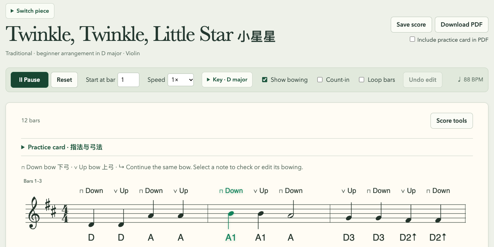

# Stringbook · Violin fingering and bowing for beginners

Know the tune but still have to stop and work out where your fingers go? Stringbook writes the **string and finger below each note** and the **bow direction above it**. Follow the staff for rhythm, hear the melody at your pace, then print the same markings for your music stand.

[Open a printable score and practice card (2-page PDF)](docs/media/twinkle-practice-score.pdf) · [See both hands in action](#see-both-hands-in-action) · [Run Stringbook](#run-stringbook)



The first five notes of *Twinkle, Twinkle, Little Star* read **D · D · A · A · A1**. Play the open D string twice, the open A string twice, then put your index finger on the A string. Later in the phrase, **D2↑** asks for a high second finger on the D string. The arrow below the staff describes finger placement.

## See both hands in action

Select a note to see its place on the violin and which way to move the bow. The practice card collects the fingerings used in that piece. You can include it as the last page of your PDF.

<details>
<summary>Watch 8 seconds of playback and note selection</summary>


</details>

## Bring a tune

| Start with | What to try |
| --- | --- |
| A photo or scan | Import a PNG or JPEG of sheet music and choose the part to play. [Sample score image](samples/rhythm.png) |
| A PDF score | Select the pages and melody part. [Sample PDF](samples/placement.pdf) |
| A song title | Search the seven offline starters by English or Chinese name, or find a specific edition in the OpenScore Lieder catalogue. Try **小星星** or **Die Forelle**. |
| A recording | Turn a solo melody into a draft you can listen to and correct. [Four-second audio sample](samples/melody.wav) |

Compare a generated draft with the original before practicing. You can correct pitches, rhythm, fingering and bowing, transpose to another key, and save your edits. Imports and saved scores stay on your computer. Fetching an online score needs internet access.

## Run Stringbook

The setup script supports **macOS on Apple Silicon**. Install Node.js 24 with npm, uv, FFmpeg and Google Chrome first. [Prerequisite commands and setup details](INSTRUCTIONS.md#recreate-the-environment)

```sh
git clone https://github.com/dhtim135/violin-for-beginner.git
cd violin-for-beginner
./scripts/setup.sh
./scripts/start.sh
```

Open **[Stringbook on localhost](http://127.0.0.1:8427)**. *Twinkle* is ready to play. For a first practice loop, set **Speed** to **0.75×**, turn on **Loop bars**, choose bars **1–2**, and press **Play**. Click the first **A1** to see where your finger lands. **Esc** returns you to the score.

## Feedback and contributions

Which note made you stop? If a fingering feels awkward, tell us the piece, bar, displayed label and what you would play instead. Reports from beginners and teachers are welcome. [Open an issue](https://github.com/dhtim135/violin-for-beginner/issues) · [Contribute code or a score](CONTRIBUTING.md)

Star Stringbook if you’d like to find it again for your next practice session.

For development, start with the [product scope](PRODUCT.md), [architecture](ARCHITECTURE.md), [milestones](MILESTONES.md), [testing guide](TESTING.md) and [repository conventions](AGENTS.md).

## License and music credits

Stringbook is **source-available** under PolyForm Noncommercial 1.0.0. The license covers contributors’ original code, documentation, exercises and arrangements to the extent they hold the rights. Personal study and use by educational institutions, including those charging tuition, are permitted. Selling the app or running a paid hosted service requires separate permission. [Full license](LICENSE) · [Permission inquiries](https://github.com/dhtim135/violin-for-beginner/issues)

When sharing a copy, include the license or its official URL and the following notice.

> Required Notice: Copyright Stringbook contributors

Third-party software, score editions and recordings have their own terms. [Music and dependency credits](THIRD_PARTY_NOTICES.md)
